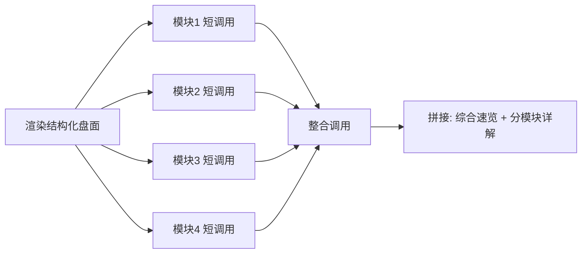

# 三盘命理智能分析平台

八字 + 紫微斗数 + 奇门遁甲三盘整合的命理分析平台：**引擎负责计算，LLM 只做解读与整合**。

核心设计约束是「算得准的不交给模型」——排盘全部由确定性算法完成，大模型只承担它擅长的语义组织与表达，避免让 LLM 编造干支、宫位这类可校验的事实。

> **免责声明**：本项目为传统文化与历法计算的技术研究实现，分析结果仅供娱乐与文化研究参考，不构成任何人生决策建议。请勿用于医疗、法律、金融等场景。

---

## 核心特性

- **三套排盘引擎统一接入**
  - 八字：`lunar-python` 排四柱，含真太阳时校正
  - 紫微斗数：Node 子进程桥接 `iztro` 排十二宫
  - 奇门遁甲：自研起局引擎
- **可降级的 provider 路由**：每盘独立配置 `local | thirdparty`，本地引擎失败时按 `ALLOW_FALLBACK` 自动切换第三方，单盘故障不影响整体出盘
- **LLM 解读管线优化**：分模块并行短调用 + 一次整合调用，端到端耗时 **64s → 16s（-75%）**
- **Prompt 外置数据库**：模板存 MySQL，支持热更新与多模型切换，改提示词无需重启服务；灌库幂等，重复执行只更新版本不产生重复
- **8 个可分析模块**：事业 / 财运 / 感情 / 健康 / 学业 / 家庭 / 运势 / 性格，默认综合解读取其中 4 个，可按需勾选
- **落库与可观测**：排盘记录、解读报告、分模块正文、LLM 调用日志（含 token 与耗时）全部落 MySQL
- **移动端优先单文件 SPA**：录入 → 排盘 → 解读三步，大运流年点击联动高亮对应宫位
- **非阻塞存储**：数据库连接失败时降级为不落库，接口照常返回

---

## 技术栈

| 层 | 选型 |
| --- | --- |
| 后端 | FastAPI、Pydantic v2、pydantic-settings |
| LLM | OpenAI 兼容协议（DeepSeek / 通义千问 / 豆包可切换） |
| 排盘 | lunar-python、iztro（Node 桥接）、自研奇门引擎 |
| 存储 | MySQL 8.0（PyMySQL） |
| 并发 | asyncio + asyncio.to_thread（同步 SDK 不阻塞事件循环） |
| 前端 | 原生单文件 SPA（index.html + region-data.js） |
| 测试 / 部署 | pytest、Dockerfile |

---

## 架构

```
┌─────────────────────────────────────────────────┐
│  前端 SPA（移动端优先，单文件）                  │
│  录入 → 排盘 → 解读 → 大运流年联动              │
└──────────────────────┬──────────────────────────┘
                       │ /api/v1/*
┌──────────────────────▼──────────────────────────┐
│  FastAPI 路由层（可选 API Key 鉴权）             │
│  /chart  /interpret  /modules  /health           │
└──────────┬───────────────────────────┬──────────┘
           │                           │
┌──────────▼──────────┐   ┌────────────▼──────────┐
│  chart_service      │   │  interpret_service    │
│  三盘并行排盘        │   │  Prompt 渲染 + LLM     │
└──────────┬──────────┘   └────────────┬──────────┘
           │                           │
┌──────────▼───────────────────────────▼──────────┐
│  engines（bazi / ziwei / qimen）                 │
│  + adapters/thirdparty（降级 provider）          │
└──────────────────────┬──────────────────────────┘
                       │
┌──────────────────────▼──────────────────────────┐
│  MySQL：prompts 模板 / 排盘记录 / 报告 / 调用日志 │
└─────────────────────────────────────────────────┘
```

**为什么引擎和 LLM 要分开**：命理盘面是确定性结果，交给 LLM 算会出现幻觉（干支、宫位落错且难以校验）。本项目让算法保证事实正确，LLM 只负责把结构化盘面翻译成自然语言，并对每个模块给出分析。

---

## 目录结构

```
bazi/
├── app/
│   ├── main.py                 # FastAPI 入口，根路径挂载前端静态资源
│   ├── core/                   # 配置、schemas、数据库访问
│   ├── engines/                # bazi.py / ziwei.py / qimen.py 三套排盘引擎
│   ├── adapters/               # thirdparty.py 第三方排盘降级适配
│   ├── prompts/                # 提示词模板 + 模块定义
│   ├── routers/                # api.py 路由与鉴权
│   ├── services/               # chart_service / interpret_service / llm
│   └── seed_prompts.py         # 提示词模板灌库脚本
├── node_ziwei/                 # iztro 紫微排盘 Node 脚本
├── frontend/                   # index.html + region-data.js（省市区数据）
├── schema.sql                  # 建库建表脚本（MySQL 8.0）
├── tests/test_smoke.py         # 全链路冒烟测试
├── tests/test_interpret_degrade.py  # 解读降级路径测试（llm.chat 打桩）
├── Dockerfile
└── requirements.txt
```

---

## 快速开始

### 1. 创建虚拟环境（推荐）

```bash
# Windows (PowerShell)
python -m venv .venv
.\.venv\Scripts\Activate.ps1

# macOS / Linux
python3 -m venv .venv
source .venv/bin/activate
```

> `.venv` 已被 `.gitignore` 排除，不会提交。

### 2. 安装依赖

```bash
pip install -r requirements.txt        # Python 依赖
cd node_ziwei && npm install && cd ..  # 紫微斗数依赖（iztro），需要 Node 18+
```

### 3. 配置环境变量

```bash
cp .env.example .env
```

至少要填 `LLM_API_KEY` 才能使用解读功能；只排盘不需要。可选修改 `LLM_BASE_URL` / `LLM_MODEL` 切换模型提供商。

### 4. 初始化数据库（可选）

```bash
mysql -u root -p < schema.sql   # 建库 mingpan + 建 9 张业务表
python -m app.seed_prompts      # 灌入提示词模板与模块配置（幂等）
```

`DB_ENABLED=false` 可完全跳过数据库，此时解读功能仍可用（使用内置模板兜底）。

### 5. 启动

```bash
uvicorn app.main:app --reload --port 8000
```

- 前端：<http://localhost:8000>
- API 文档：<http://localhost:8000/docs>

Docker：

```bash
docker build -t bazi .
docker run -p 8000:8000 --env-file .env bazi
```

### 6. 验证

```bash
# 健康检查（应返回 status: ok）
curl http://127.0.0.1:8000/api/v1/health

# 只排盘（返回结构化三盘）
curl -X POST http://127.0.0.1:8000/api/v1/chart \
  -H "Content-Type: application/json" \
  -d '{"birth":{"year":1995,"month":8,"day":18,"hour":9,"minute":30,"gender":"male","birth_place":"上海"}}'
```

浏览器打开 <http://127.0.0.1:8000> 录入出生信息即可体验排盘与解读。

---

## 环境变量

| 变量 | 说明 | 默认 |
| --- | --- | --- |
| `LLM_BASE_URL` / `LLM_API_KEY` / `LLM_MODEL` | OpenAI 兼容协议，支持 DeepSeek / 千问 / 豆包 | — |
| `LLM_TIMEOUT` | 单次调用超时（秒） | 120 |
| `PROVIDER_BAZI` / `PROVIDER_ZIWEI` / `PROVIDER_QIMEN` | 每盘的 provider：`local` 或 `thirdparty` | local |
| `ALLOW_FALLBACK` | 本地引擎失败是否降级到第三方 | true |
| `ZIWEI_MODE` | `per_process`（每次 fork node）/ `node_service`（常驻服务，生产推荐） | per_process |
| `TRUE_SOLAR_TIME` | 真太阳时校正 | true |
| `DB_ENABLED` / `DB_*` | MySQL 落库，连不上不阻塞接口 | true |
| `API_KEYS` | 逗号分隔的 API Key，配置后强制鉴权 | 空（不鉴权） |

---

## API

前缀 `/api/v1`。配置 `API_KEYS` 后需在请求头携带 `Authorization: Bearer <key>`。

| 方法 | 路径 | 说明 |
| --- | --- | --- |
| GET | `/health` | 健康检查，返回 LLM 配置状态与各盘 provider |
| POST | `/chart` | 只排盘，返回结构化三盘数据 |
| POST | `/interpret` | 排盘 + LLM 解读，支持 `overview` / `focus` 两种模式 |
| GET | `/modules` | 查询可分析的模块列表 |

`mode=overview` 走综合解读（多模块并行，默认取 career / wealth / love / personality 四个），`mode=focus` 针对单个问题深挖（必须传 `question`）。模块实时列表以 `/modules` 返回为准。

---

## 解读管线：64s 是怎么降到 16s 的

这是本项目最主要的性能优化点。

**优化前**：把完整盘面 + 所有模块要求塞进一次长调用，让模型一次生成全部内容。问题是输出越长越慢，且单次失败就全盘皆输。

**优化后**：拆成「并行短调用 + 一次整合调用」。



关键实现：

1. `asyncio.gather` + `asyncio.to_thread` 并发各模块调用——LLM SDK 是同步的，必须丢进线程池，否则会阻塞事件循环拖垮整个服务；
2. 每个模块限制 `max_tokens=1200`，输出短则延迟低；
3. 整合调用只吃各模块前 600 字摘要，避免 prompt 无限膨胀；
4. `return_exceptions=True` + 逐模块兜底文案——**单个模块失败只降级该模块，不会让整次解读失败**。

实测（4 模块 + 一次整合调用）端到端耗时从 **64s 降到 16s**。附带收益是可观测性：每个模块的 token 与耗时单独统计，哪里慢一目了然。

---

## 数据落库

| 表 | 内容 |
| --- | --- |
| 排盘记录 | 输入参数与三盘结构化结果 |
| 解读报告 | 报告编号、模式、正文、LLM 元信息 |
| 报告模块 | 按模块拆分的小节正文与排序 |
| 调用日志 | 每次 LLM 调用的 scene、token、耗时 |

写入失败不影响接口返回。用户手机号等敏感字段做降敏存储。

---

## 测试

```bash
pytest -v
```

`tests/test_smoke.py` 覆盖排盘与解读的 6 项全链路冒烟用例；`tests/test_interpret_degrade.py` 另含 5 项解读降级路径用例（模块失败 / 整合失败 / CancelledError / 空结果，`llm.chat` 打桩，不依赖真实 LLM 与数据库）。

---

## 已知限制与后续

坦白说明当前处于 MVP 阶段：

- 紫微 `per_process` 模式每次调用 fork 一次 Node，冷启动开销明显；生产应切 `node_service` 常驻模式
- 整合调用目前串行依赖所有模块完成，可考虑模块分批放行以进一步压缩首字延迟
- 缺少 LLM 输出的格式校验与自动重试，偶发不合规 Markdown 会导致模块切分落到 `raw`
- 无缓存层，相同盘面重复解读会重复计费
- 解读结果暂未做向量化检索，无法支持「历史解读问答」

---

## License

MIT
